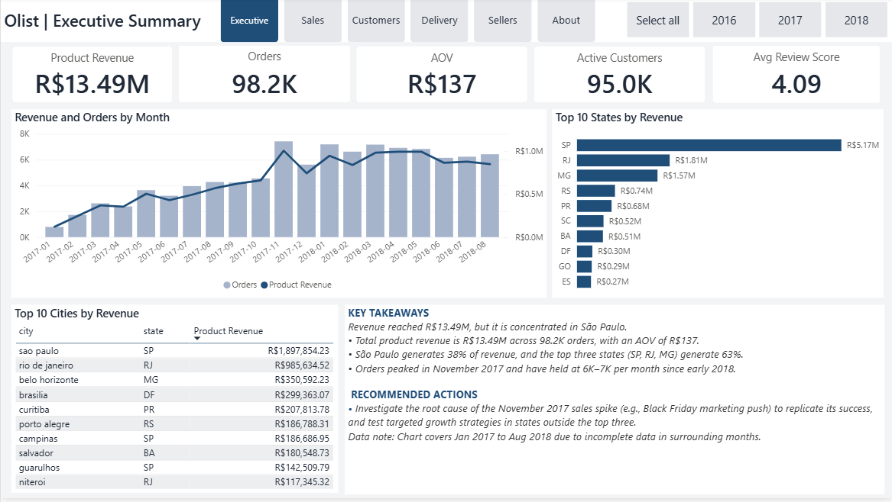

# Olist E-Commerce Analytics Warehouse

End-to-end analytics project on the Olist Brazilian e-commerce dataset (2016–2018). A SQL Server 2022 warehouse (Bronze, Silver, Gold) feeds a six-page Power BI dashboard that answers ten business questions on revenue, customers, delivery, and sellers.

**Key numbers:** 98.2K valid orders · R$13.49M product revenue · 95K customers · 3,053 sellers.

## Dashboard



| Page # | Page | Answers | Screenshot |
|---|---|---|---|
| 1 | Executive | Revenue and orders trend, geography (Q1, Q2) | [View 01](docs/screenshots/01_executive.PNG) |
| 2 | Sales & Products | Categories, payments, installments, freight (Q5, Q6, Q10) | [View 02](docs/screenshots/02_sales.PNG) |
| 3 | Customers | RFM segments, repeat rate, cohorts (Q3, Q4) | [View 03](docs/screenshots/03_customers.PNG) |
| 4 | Delivery & Reviews | Late rate and its effect on reviews (Q7, Q8) | [View 04](docs/screenshots/04_delivery.PNG) |
| 5 | Sellers | Seller status and risk (Q9) | [View 05](docs/screenshots/05_sellers.PNG) |
| 6 | About | KPI definitions and data notes | [View 06](docs/screenshots/06_about.PNG) |

## Architecture


Source CSV files → **Bronze** (raw) → **Silver** (cleansed) → **Gold** (star schema) → **Power BI**

Full design, requirements, and KPI definitions are in [`docs/`](docs/).

## Setup

**Prerequisites:** SQL Server 2022, SQL Server Management Studio (SSMS), Power BI Desktop.

1. Clone the repository.
2. Download the nine CSV files from [Kaggle](https://www.kaggle.com/datasets/olistbr/brazilian-ecommerce) into a local `datasets/` folder. Keep the folder out of Git.
3. **Build the structure (run once).** In SSMS, run these files in order:
   1. `scripts/00_init/01_create_database.sql`
   2. `scripts/00_init/02_ddl_audit.sql`
   3. `scripts/01_bronze/ddl_bronze.sql`
   4. `scripts/02_silver/ddl_silver.sql`
   5. `scripts/03_gold/ddl_gold_views.sql`
   6. `scripts/01_bronze/proc_load_bronze.sql`
   7. `scripts/02_silver/proc_load_silver.sql`
   8. `scripts/03_gold/proc_load_gold.sql`
   9. `scripts/orchestration/proc_run_pipeline.sql`
4. **Load the data (run every time the source files change).** Replace the placeholder with the full path to your `datasets/` folder:
   ```sql
   EXEC audit.run_pipeline @source_path = N'<path to datasets folder>';
   ```
5. **Create the analytics views (run once, after step 4).**
   1. `scripts/04_analytics/views/customer_rfm.sql`
   2. `scripts/04_analytics/views/cohort_retention.sql`
   3. `scripts/04_analytics/views/seller_scorecard.sql`
6. **Run the data quality tests (after step 4).** Run `scripts/tests/test_silver.sql` once to create the test procedure, then:
   ```sql
   EXEC audit.run_silver_tests;
   ```
   Each check should return PASS in `audit.test_results`.
7. Open `powerbi/olist_dashboard.pbix`, set the data source to your SQL Server instance, and refresh.

## Limitations

- Repeat purchasing is rare (about 3%), so retention conclusions are limited.
- Late delivery and review scores show an association, not proof that delay causes lower scores.
- The dataset is anonymized, and customer and seller identities are not real.

Full data notes: [`docs/01_business_framing.md`](docs/01_business_framing.md) and [`docs/methodology.md`](docs/methodology.md).
