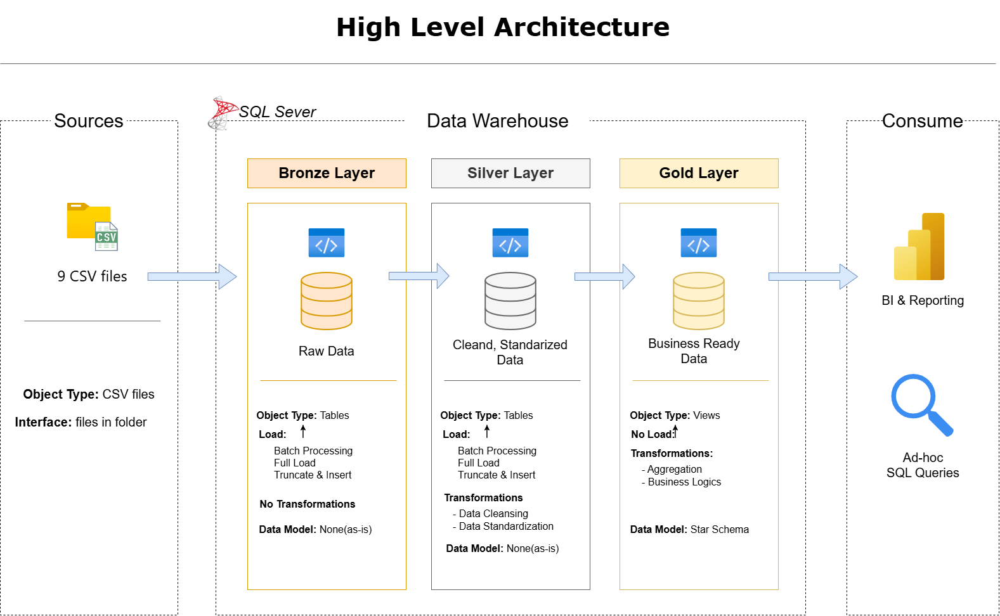

# Olist E-Commerce Data Warehouse & Analytics

End-to-end analytics project on the Brazilian Olist e-commerce dataset:
a SQL Server data warehouse (Medallion architecture) with a Power BI dashboard.

> 🚧 Work in progress

## Architecture

## Tech Stack
SQL Server · T-SQL · Power BI · Git · Draw.io

## Project Documentation
- [Business Framing](docs/01_business_framing.md)
- [Requirements](docs/02_requirements.md)

## Naming Conventions
| Item | Convention | Example |
|---|---|---|
| General | `snake_case`, lowercase | `order_purchase_date` |
| Schemas | `bronze`, `silver`, `gold`, `audit` | `bronze.orders` |
| Dimensions | `dim_` + singular noun | `gold.dim_customer` |
| Facts | `fact_` + noun | `gold.fact_orders` |
| Surrogate keys | `<entity>_key` | `customer_key` |
| Business keys | `<entity>_id` | `order_id` |
| Technical columns | `dwh_` prefix | `dwh_load_date` |
| Procedures | `load_<layer>` | `bronze.load_bronze` |

## Dataset
[Brazilian E-Commerce Public Dataset by Olist (Kaggle)](https://www.kaggle.com/datasets/olistbr/brazilian-ecommerce)
Download the CSV files into the `datasets/` folder.
