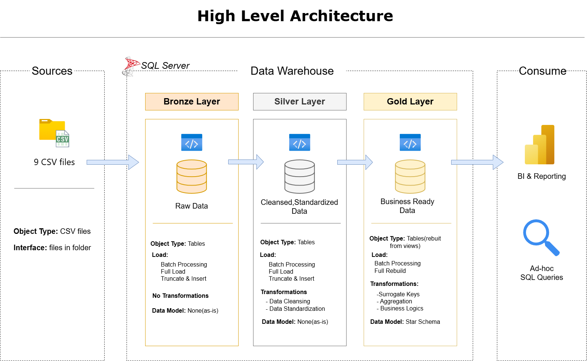

# Olist E-Commerce Analytics Warehouse

End-to-end analytics project on the Olist Brazilian e-commerce dataset. A SQL Server 2022 warehouse (Bronze, Silver, Gold) feeds a 6-page Power BI dashboard that answers ten business questions on revenue, customers, delivery, and sellers.

## Documentation
- [Business Framing](docs/01_business_framing.md): objective, stakeholders, questions, key decisions, scope
- [Requirements](docs/02_requirements.md): data sources, quality rules, functional and non-functional requirements
- [Data Catalog](docs/data_catalog.md): Gold tables, columns, grain, and keys
- [KPI Definitions](docs/kpi_definitions.md): how each dashboard number is calculated
- [Methodology](docs/methodology.md): customer segment and seller status rules, and the decision log

## Architecture


Source CSV files → **Bronze** (raw, as-is) → **Silver** (typed, cleansed, deduplicated) → **Gold** (star schema tables) → **Power BI**.

Power BI imports Gold tables and `analytics` objects only. It does not read Bronze, Silver, or `gold_views` directly.

Other diagrams: [Data Flow](docs/data_flow.png) · [Data Model](docs/data_model.png)

## Data Model
- **Facts:** `gold.fact_orders`, `gold.fact_order_items`, `gold.fact_payments`
- **Dimensions:** `gold.dim_customer`, `gold.dim_product`, `gold.dim_seller`, `gold.dim_date`
- **Analytics:** `analytics.customer_rfm`, `analytics.cohort_retention`, `analytics.seller_scorecard`

Revenue comes from order items, not payments.

## Tech Stack
SQL Server 2022 · T-SQL · Power BI Desktop · Git · draw.io

## Repository Structure
```
datasets/      source CSV files (not committed; see Setup)
docs/          documentation and diagrams
powerbi/       dashboard (.pbix)
scripts/
  00_init/         database and audit objects
  01_bronze/       Bronze DDL and load procedure
  02_silver/       Silver DDL, load procedure, Bronze profiling
  03_gold/         Gold views (gold_views) and materialization procedure
  04_analytics/    analytics views and KPI / root-cause queries
  orchestration/   audit.run_pipeline
  tests/           data quality checks
```


## Naming Conventions
| Item | Convention | Example |
|---|---|---|
| General | `snake_case`, lowercase | `order_purchase_date` |
| Schemas | `bronze`, `silver`, `gold`, `gold_views`, `analytics`, `audit` | `bronze.orders` |
| Dimensions | `dim_` + singular noun | `gold.dim_customer` |
| Facts | `fact_` + noun | `gold.fact_orders` |
| Analytics objects | noun describing the output | `analytics.customer_rfm` |
| Surrogate keys | `<entity>_key` | `customer_key` |
| Business keys | `<entity>_id` | `order_id` |
| Date keys | `YYYYMMDD` integer | `20170115` |
| Flags | `is_` prefix, values 0 or 1 | `is_late` |
| Procedures | `load_<layer>` in the layer's schema | `gold.load_gold` |
| SQL scripts | numbered folder per layer; `ddl_<layer>.sql`, `proc_load_<layer>.sql` | `scripts/01_bronze/ddl_bronze.sql` |
| Technical columns | `dwh_` prefix | `dwh_create_date` |

## Setup

**Prerequisites:** SQL Server 2022, SQL Server Management Studio (SSMS), Power BI Desktop.

1. Clone the repository.
2. Download the nine CSV files from [Kaggle](https://www.kaggle.com/datasets/olistbr/brazilian-ecommerce) into a local `datasets/` folder. Keep the folder out of Git.
3. In SSMS, run these scripts in order:
   1. `scripts/00_init/01_create_database.sql`
   2. `scripts/00_init/02_ddl_audit.sql`
   3. `scripts/01_bronze/ddl_bronze.sql`
   4. `scripts/01_bronze/proc_load_bronze.sql`
   5. `scripts/02_silver/ddl_silver.sql`
   6. `scripts/02_silver/proc_load_silver.sql`
   7. `scripts/03_gold/ddl_gold_views.sql`
   8. `scripts/03_gold/proc_load_gold.sql`
   9. `scripts/04_analytics/views/customer_rfm.sql`
   10. `scripts/04_analytics/views/cohort_retention.sql`
   11. `scripts/04_analytics/views/seller_scorecard.sql`
   12. `scripts/orchestration/proc_run_pipeline.sql`
4. **Load the data (run every time the source files change).** Replace the placeholder with the full path to your `datasets/` folder:
   ```sql
   EXEC audit.run_pipeline @source_path = N'<path to datasets folder>';
   ```
   This loads Bronze, Silver, and Gold, runs the quality gates, and logs the run in `audit.load_log`.
5. Run the data quality tests:
   ```sql
   EXEC audit.run_silver_tests;
   ```
   Then run the checks in `scripts/tests/`. Each query should return no rows.
6. Open `powerbi/olist_dashboard.pbix`, set the data source to your SQL Server instance, and refresh.

`scripts/02_silver/profiling_bronze.sql` and `scripts/04_analytics/queries/` are exploration files. They are not part of the pipeline.

## Data Notes and Limitations
- The dataset is anonymized. Customer and seller identities are not real.
- Data covers Sep 2016 to Oct 2018. Charts show Jan 2017 to Aug 2018, because the first and last months are incomplete.
- Repeat purchasing is rare (about 3%), so retention conclusions are limited.
- Reviews are optional and may over-represent unhappy customers.
- A few orders have no items (mostly canceled or unavailable). They are excluded from revenue and customer metrics.
- Delivery metrics use delivered orders only.
- Seller metrics are per seller and all-time. 42 registered sellers without valid orders are excluded from status counts.
- Summary cards on the Customers and Sellers pages ignore the year filter.
- Late delivery and review scores show an association, not proof that delay causes lower scores. Distance within states is not in the dataset and is not controlled for.

## Out of Scope
Customer lifetime value (LTV), Row-Level Security (RLS), incremental load, machine learning, real-time ingestion, cloud deployment.

## Author
Menna Azab · [GitHub](https://github.com/mennaazabb)